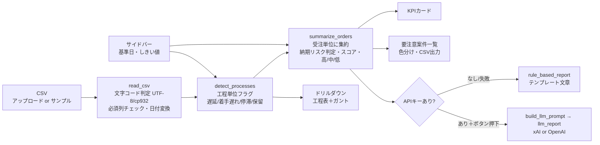

# 納期遅れ・停滞 早期検知デモ — 設計書（壁打ち用）

> 実装（`app.py` / `logic.py` / `generate_sample.py`）に基づく記述です。2026-11-01時点。

## 1. 目的と想定ユーザー
| 項目 | 内容 |
|---|---|
| 目的 | 町工場（従業員10〜100名規模の板金・機械加工）への**AI導入の営業デモ**。「Excel/CSVの工程表を入れるだけで、遅れ・停滞を自動で拾い、今週やるべきことを文章で出せる」ことを体感してもらう |
| 想定ユーザー | 社長・工場長・生産管理担当（ITに詳しくない前提）。操作者はデモ時は林（コンサルタント） |
| 価値の訴求点 | ①見逃し防止（停滞・着手遅れ）②優先順位の自動化 ③顧客への事前連絡など「打ち手」まで提示 |
| 位置づけ | PoC／デモ。本番運用（DB連携・権限・通知）は未実装 |

## 2. 全体構成
### ファイル構成
| ファイル | 役割 |
|---|---|
| `app.py` | ルーター（`st.navigation`、ナビ非表示）。`/` → `delay_demo.py`、`/inventory` → `inventory_demo.py`（§12） |
| `delay_demo.py` | Streamlit画面（サイドバー・KPI・3タブ）。旧 `app.py` の内容をそのまま移動 |
| `logic.py` | 読み込み・検知・スコア・レポート生成（Streamlit非依存の純粋関数） |
| `generate_sample.py` | 架空サンプルCSV生成（固定シード42＋手作り問題ケース） |
| `sample_orders.csv` | サンプルデータ（28受注・123工程行、UTF-8 BOM付） |
| `test_logic.py` / `test_app.py` | ロジック検証／Streamlit AppTestによる画面検証 |
| `requirements.txt` / `README.md` | 依存（streamlit, pandas, plotly, requests）／使い方 |

### 処理の流れ


## 3. CSV仕様（1行 = 1受注の1工程）
| 列 | 型 | 説明 |
|---|---|---|
| order_id | 文字 | 受注番号（同一受注の工程は同じID） |
| customer / product | 文字 | 顧客名／品名（受注内の先頭行の値を使用） |
| qty | 数値 | 数量 |
| due_date | 日付 | 納期（受注内の先頭行の値を使用） |
| process_seq | 数値 | 工程順（この順でソート） |
| process_name | 文字 | 切断・曲げ・溶接・機械加工・表面処理・検査・出荷 等（自由） |
| planned_start / planned_end | 日付 | 予定開始／予定完了 |
| actual_start / actual_end | 日付 | 実績（空欄可） |
| status | 文字 | `未着手` / `着手中` / `完了` / `保留` |
| last_updated | 日付 | 最終更新日（停滞判定に使用） |
| note | 文字 | メモ（保留キーワード判定に使用） |
| material_arrival | 日付 | 任意。材料入荷日。列が無くても読み込める。未完了工程で着手予定より後なら前兆 |

- 文字コード：UTF-8（BOM有無）→ 失敗時 Shift_JIS(cp932) を自動判定。Excelから「CSV（コンマ区切り）」保存で可。
- 必須列が欠けるとエラー表示して停止。余分な列は無視。日付は `YYYY-MM-DD` 推奨（パース不能は空扱い）。

## 4. 検知ルールとスコアリング
### 工程・受注単位のルール（today = サイドバーの基準日）
| ルール | 単位 | 条件 | 既定値 |
|---|---|---|---|
| 遅延 | 工程 | today > planned_end かつ status≠完了 | — |
| 着手遅れ | 工程 | today > planned_start かつ status=未着手 | — |
| 停滞 | 工程 | status=着手中 かつ (today − last_updated) ≥ N日 | N=3 |
| 保留 | 工程 | status=保留、**または** 未完了工程のnoteに「待ち」「不足」「確認中」を含む | — |
| 納期リスク | 受注 | Σ(未完了工程の planned_end − planned_start + 1) ＞ (due_date − today) | — |

### スコア（受注単位、加点式）
| 要素 | 加点 |
|---|---|
| 遅延 | 30 + min(30, 3×最大超過日数) |
| 着手遅れ | 15 + min(15, 2×最大着手遅れ日数) |
| 停滞 | 25 + min(20, 3×(最大未更新日数 − N)) |
| 納期リスク | 25 + min(30, 3×不足日数) |
| 保留 | 25 |
| 納期がW日以内 かつ いずれか該当（urgent） | +40（W=7） |
| 納期超過 かつ いずれか該当 | +30 |

**重要度**：urgent または スコア≥80 →「高」／ スコア≥25 →「中」／ それ以外 →「低」（問題なしも「低」、該当ルール欄は「問題なし」）。
並び順：重要度 → スコア降順 → 納期までの日数昇順。しきい値（N, W, 80, 25）はサイドバーで変更可。

### 前兆ルール（2026-11-08 追加。スコアには加点しない）
既存5ルールの「要注意」判定はそのまま。朝の「今朝見る3件」は、重要度順のまま前兆がある案件の上位3件を提案する。人が確認するまで採用しない。

| ルール | 単位 | 条件 |
|---|---|---|
| 未着手の超過 | 工程 | status=未着手 かつ today ＞ planned_start |
| 状態がN日変わらない停滞 | 工程 | status が着手中または保留 かつ (today − last_updated) ≥ N。着手予定前の未着手は対象外（動かなくて当然のため） |
| 計画と実績のズレ2日超 | 工程 | max(実績開始−予定開始, 実績完了−予定完了, 着手済み未完了で today−予定完了) ＞ 2。早まりは0 |
| 完了見込みが納期超過 | 受注 | 完了見込み = today + 残工程予定日数 + 材料待ち日数。これが due_date より後。残工程の数え方は納期リスクと同じ。材料待ちは、未着手・保留で material_arrival ＞ today の日数 |
| 材料入荷が着手予定より後 | 工程 | 未完了 かつ material_arrival ＞ planned_start |

納期への影響日数 = max(0, 完了見込み − 納期)。材料列が無いCSVでは材料の前兆は立たない。

### 実装上の判断（仕様にない部分を決めたもの）
| 判断 | 理由 |
|---|---|
| 「納期W日以内 かつ 何らかの遅れ」の「遅れ」は5ルールいずれでも可とし、強制的に「高」 | 納期直前は種類を問わず手を打つべきため |
| 保留のnote判定は**未完了工程のみ** | 完了済み工程の過去メモ（例：外注待ちだった）で誤検知しないため |
| 納期リスクは**着手中工程も全日数**で計算（進捗率を考慮しない） | CSVに進捗率がないため。保守的（やや過検知）になる |
| 日数は**暦日**（土日祝を除外しない） | シンプルさ優先。デモ用 |
| 遅延と着手遅れは重複計上あり（未着手で予定完了も過ぎた工程は両方） | 実態として両方の問題があるため |
| 受注の customer/product/due_date は先頭行の値 | 行ごとの不一致はチェックしていない |
| 「要注意案件数」= いずれかのルールに該当する受注数 | KPIの定義 |

## 5. 画面と機能
| 領域 | 内容 |
|---|---|
| サイドバー | CSVアップロード（未指定ならサンプル）／基準日（既定2026-11-10）／停滞日数N（3）／納期が近い日数W（7）／スコア境界「高」80・「中」25（折りたたみ） |
| KPIカード | 全案件数（＋工程行数）／要注意案件数／高リスク件数／停滞工程数 |
| 今朝見る3件 | タイトル直下。重要度順で前兆がある上位3案件を「提案」として出し、納期への影響日数と完了見込みを表示。人が「確認した」を押すまで未確認。APIキーは使わない。前兆5ルールの該当件数も併記 |
| タブ① 要注意案件一覧 | 重要度順の表（🔴高・🟡中・🟢低、行背景色）、スコアはプログレスバー、理由列、前兆、納期影響。「問題のない案件も表示」トグル、重要度フィルタ、ルール別件数、**抽出結果CSVダウンロード**（UTF-8 BOM、Excelで文字化けしない） |
| タブ② 案件ドリルダウン | 案件選択 → 重要度・納期・進捗・残工程日数、該当理由、**予定vs実績ガント**（plotly、基準日・納期の縦線）、工程表（検知行を赤背景） |
| タブ③ AIレポート | 「今週手を打つべき案件」レポート（Markdown）、生成元バッジ（AI生成／ルールベース生成）、.md ダウンロード |

## 6. AIレポートの仕組み
| 条件 | 動作 |
|---|---|
| `XAI_API_KEY` あり（優先） | xAI `https://api.x.ai/v1/chat/completions`、モデル既定 `grok-4` |
| `OPENAI_API_KEY` あり | OpenAI `https://api.openai.com/v1/chat/completions`、既定 `gpt-4o-mini` |
| どちらもなし | ルールベースのみ（ボタン非表示） |
| APIエラー | エラー表示し、ルールベースにフォールバック |

- モデルは `LLM_MODEL` で上書き可。temperature 0.3、タイムアウト90秒。API呼び出しはボタン押下時のみ（再描画のたびに課金しない）。
- **プロンプト概要**：system「製造業の生産管理コンサルタント、簡潔で実務的な日本語」。user に基準日・全案件数・要注意上位8件のJSON（案件・顧客・品名・数量・納期・残日数・重要度・スコア・現在工程・フラグ・理由）を渡し、「①全体所見（3行以内）②今週対応すべきトップ5（理由と推奨アクション：外注先確認・工程前倒し・顧客事前連絡など）③今週の進め方、データにない事実は創作しない」と指示。
- **ルールベース**：全体所見（件数・内訳・社外要因の有無）→ トップ5（納期・現在工程・理由・推奨アクション）→ 今週の進め方4項目。推奨アクションは note のキーワード（外注／材料／図面・確認中／人員・不足）とフラグ（停滞／遅延・着手遅れ／納期リスク、納期W日以内なら顧客へ事前連絡）から辞書的に生成。
- 現時点でボックスにAPIキーは未設定 → デモはルールベース表示。**AI呼び出しは未実機検証**。

## 7. サンプルデータの中身（基準日 2026-11-10）
28受注（すべて架空：株式会社テスト精工、サンプル電機株式会社、デモ産業株式会社 等）。正常17件はランダム生成後、フラグが出ないよう納期を調整。問題11件は手作り。

| 順位 | 受注 | 品名 | 納期(残) | 仕込んだ状況 | 検知 | スコア | 重要度 |
|---|---|---|---|---|---|---|---|
| 1 | ORD-1010 | シャフト | 11/13(3) | 機械加工が予定超過＋5日更新なし | 遅延・着手遅れ・停滞・納期リスク | 180 | 高 |
| 2 | ORD-1003 | 架台フレーム | 11/14(4) | 溶接が歪み修正で3日超過。曲げの実績完了は予定より3日遅れ | 遅延・着手遅れ・納期リスク | 135 | 高 |
| 3 | ORD-1019 | フランジ | 11/15(5) | メッキ**外注待ち**（戻り日未回答） | 遅延・納期リスク・保留 | 132 | 高 |
| 4 | ORD-1015 | 制御盤筐体 | 11/16(6) | 急ぎ追加受注で計画自体が納期超過 | 納期リスク | 77 | 高 |
| 5 | ORD-1013 | シャフト | 11/17(7) | 検査治具不具合で3日更新なし | 停滞 | 65 | 高 |
| 6 | ORD-1005 | ベースプレート | 11/19(9) | **材料待ち**（入荷11/12、切断の着手予定11/08より後） | 遅延・保留 | 58 | 中 |
| 7 | ORD-1025 | 架台フレーム | 11/18(8) | 溶接**人員不足** | 納期リスク・保留 | 53 | 中 |
| 8 | ORD-1017 | ブラケット | 11/30(20) | 再切断で切断工程が遅延 | 遅延 | 39 | 中 |
| 9 | ORD-1012 | 治具プレート | 11/20(10) | 機械加工が5日更新なし | 停滞 | 31 | 中 |
| 10 | ORD-1022 | カバー板金 | 11/26(16) | **図面確認中**で保留 | 保留 | 25 | 中 |
| 11 | ORD-1008 | ブラケット | 11/22(12) | 曲げが予定開始を過ぎて未着手 | 着手遅れ | 19 | 低 |

ルール別件数（受注）：遅延5／着手遅れ3／停滞3／納期リスク5／保留4。KPI：全28／要注意11／高5／停滞工程3。

## 8. 使い方
### 起動
```bash
cd /workspace/delay-demo
python3 -m venv .venv && . .venv/bin/activate && pip install -r requirements.txt
streamlit run app.py --server.headless true --server.port 8501   # → http://localhost:8501
python test_logic.py && python test_app.py                         # 動作確認
```
### 自社データの入れ方
1. 工程表（Excel等）を上記14列に合わせて整形（1工程1行）。最低限 予定日・status・last_updated があれば判定可能。
2. CSV保存（UTF-8 または Shift_JIS）→ サイドバーからアップロード。
3. 基準日を「今日」に変更。しきい値を自社の感覚（例：停滞2日）に合わせる。

### デモで見せる順番（例：10分）
1. **課題提起**（1分）：「遅れに気づくのが出荷直前になっていませんか？」
2. **KPIカード**（1分）：28件中11件が要注意、高5件 ── 一目で状況把握
3. **一覧**（2分）：上位から理由を読み上げ。「外注待ち」「5日更新なし」など見逃しやすい例を強調
4. **ドリルダウン**（2分）：ORD-1010 のガントで予定と実績のズレを見せる
5. **しきい値を動かす**（1分）：停滞3→2日、基準日を1日進めると件数が変わる＝自社ルールに合わせられる
6. **AIレポート**（2分）：「今週の朝会でそのまま使える」文章。推奨アクションまで出る点を訴求
7. **CSVダウンロード／自社データの話**（1分）：「御社の工程表で試しませんか？」へ

## 9. 既知の制約・未実装
- 暦日計算（休日カレンダーなし）、工程の並行作業・設備負荷（キャパシティ）は考慮しない
- 着手中工程の進捗率がないため納期リスクはやや過検知
- 1受注内の customer/due_date 不一致、日付パース失敗、status表記ゆれ（例：「済」）の検証・警告なし
- データ保存・履歴（前週比）・ユーザー認証・通知（メール/LINE/Slack）なし
- AI API呼び出しは実キーで未検証。AIレポートの内容検証（ハルシネーション対策）はプロンプト指示のみ
- スマホ表示は最適化していない（Streamlit標準のレスポンシブのみ）
- ボックス上で起動しているだけで、固定の公開URLはない（§11参照）

## 10. 改善候補と壁打ちで聞きたい論点
1. **スコアの重み付けは妥当か？** 町工場の現場感覚で「保留（社外要因）」と「停滞（社内）」はどちらを重く見るべきか
2. **入力の手間をどう減らすか？** 現場が last_updated を毎日更新するのは現実的か。Excel／紙の日報／生産管理システムからの取り込み方法
3. **納期リスク判定の精度向上**：進捗率・休日カレンダー・設備負荷をどこまで入れるべきか（デモとしての分かりやすさとのバランス）
4. **AIレポートの価値の出し方**：ルールベースで十分では？と言われた時、LLMならではの価値（メモ文の解釈、顧客連絡文の下書き、過去の遅延傾向の要約）をどう示すか
5. **通知・運用**：毎朝LINE/メールで「今日の要注意トップ3」を送る形にすべきか
6. **営業デモとしての見せ方**：10分デモの構成、刺さる問題ケース、ROIの示し方（遅延による失注・特急費用の削減額）
7. **導入ステップと価格設計**：PoC（自社CSVで1回確認）→ 月額運用の流れと価格感
8. **データの取り扱い**：顧客データをクラウドAPIに送ることへの懸念への説明・対策（匿名化、ローカルLLM）

## 11. 公開方法の選択肢
| 方法 | 費用 | 必要なもの | URL | 長所 | 短所 |
|---|---|---|---|---|---|
| **一時トンネル**（cloudflared quick tunnel：`cloudflared tunnel --url http://localhost:8501`） | 無料 | cloudflared のみ（アカウント不要）、起動中のPC/サーバー | `https://xxxx.trycloudflare.com`（**再起動のたびに変わる**） | 数分で公開、スマホ確認に最適 | 一時的・URL変動・稼働機が止まると見られない。誰でもアクセス可（URLを知っていれば） |
| **Streamlit Community Cloud** | 無料 | GitHubアカウント＋公開（または連携した）リポジトリ、`requirements.txt`、Streamlitアカウント。APIキーは Secrets に設定 | `https://<任意名>.streamlit.app`（**固定**） | 固定URL・常時公開・git push で自動更新。営業資料に載せられる | 一定時間アクセスがないとスリープ（起動に数十秒）。公開アプリは基本誰でも見られる（閲覧者制限は可能だが要設定）。リソース制限 |
| Hugging Face Spaces（Streamlit/Docker） | 無料枠あり | HFアカウント、リポジトリにコード一式 | `https://huggingface.co/spaces/<user>/<name>`（固定） | GitHub不要、無料で常時公開 | スリープあり、ビジネス用途の見え方はやや「技術者向け」 |
| ngrok | 無料枠あり | ngrokアカウント＋authtoken | 無料でも固定ドメイン1つ可 | 手軽、固定ドメイン | 無料版は警告ページ表示、稼働機が必要 |
| Render / Railway / Cloud Run 等 | 無料〜数百円/月 | アカウント、GitHub連携 or Docker、起動コマンド設定 | 固定（独自ドメイン可） | 本番運用に近い、認証追加も可能 | 設定の手間、従量課金の可能性 |
| 社内PCで起動しLAN内共有 | 無料 | 顧客先PCにPython環境 | `http://<PCのIP>:8501` | データが社外に出ない | 社外から見られない、環境構築が必要 |

**おすすめ**：営業用の常設デモは **Streamlit Community Cloud**（サンプルデータは架空なので公開リポジトリで問題なし）。顧客の実データを扱う段階では、認証付きの有料ホスティングか顧客社内での起動を検討。

> 注：2026-11-01 にこのボックス上で cloudflared quick tunnel を試したが、ボックスのネットワークが Cloudflare エッジ（ポート7844、QUIC/HTTP2とも）への接続を遮断しており、トンネルは確立できなかった（`cloudflared.log` 参照）。

## 12. Bデモ：在庫の見える化（/inventory）
> 2026-11-04 追加。営業アプローチのA/Bテスト用。A＝納期遅れ検知（ルートURL）、B＝在庫の見える化（`/inventory`）。

| 項目 | 内容 |
|---|---|
| URL | `https://hayashi-delay-demo.streamlit.app/inventory`（ルートのAデモは従来どおり。ナビは `position="hidden"` でルートからは見えない） |
| コンセプト | **L0：マスタ登録なし**。手元の在庫表（Excel/CSV）をそのまま読み込むだけで「欠品しそうな品」「在庫が多すぎる品」を一覧化 |
| ファイル | `inventory_demo.py`（画面）／`inventory_logic.py`（読み込み・判定・レポート、Streamlit非依存）／`generate_inventory_sample.py` → `sample_inventory.xlsx`・`.csv`（架空48品目）／`test_inventory.py` |
| 必要な列 | 「品番 or 品名」「現在庫」「月平均出荷（または 直近Nヶ月出荷／日平均出荷）」。任意：発注点・安全在庫、入荷予定（発注残）、単価 |
| 列名ゆれ | NFKC正規化＋別名辞書（例：在庫数・手持在庫、品目コード・型番、注残・発注残、原価、英語名）で完全一致→部分一致。表の上のタイトル行は自動スキップ（列名らしい行を上15行から探索）、合計行・空行は除外、カンマ付き数値OK、UTF-8/Shift_JIS、Excelは列名一致が最も多いシートを採用 |
| 判定（1か月＝30日） | 在庫日数＝現在庫÷(月平均出荷÷30)。🔴欠品危険：入荷予定込みでもN日以下（既定14）／🟡欠品注意：現在庫だけではN日以下だが入荷予定で回避、または発注点以下／🔵過剰在庫：入荷予定込みでMか月分超（既定3）／⚪動きなし：出荷0で在庫あり |
| KPI | 欠品リスク品目数（うち危険）／過剰在庫品目数（動きなし含む）／過剰在庫の金額（目安＝Mか月分を超える手元在庫×単価。単価列がなければ全品目数） |
| 画面 | スマホ前提で `layout="centered"`、アップロードとしきい値（エキスパンダー）は本文に配置（サイドバーはスマホで隠れるため）。タブ：欠品リスク／過剰在庫／全品目（判定CSV出力）／AIレポート。表は列見出しで並べ替え可 |
| AIレポート | Aデモと同じ仕組み（`logic.llm_provider` / `llm_report` を再利用、ボタン押下時のみ呼び出し、失敗・キー未設定時はルールベース `inventory_rule_report`） |
| サンプル結果（既定しきい値） | 48品目：欠品危険6・欠品注意4・過剰在庫7・動きなし2・適正29。過剰在庫の金額 約250万円（在庫金額合計 約904万円） |
| 制約 | 入荷予定の日付は扱わない（数量のみ）。出荷の季節変動・ロット・リードタイムは考慮しない。単位の混在チェックなし |
